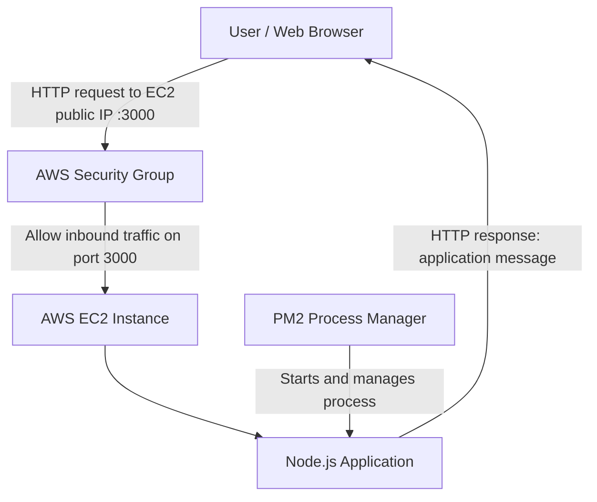

# Node.js Application Deployment on AWS EC2

## 1. Introduction

This project demonstrates how to run a simple Node.js application on an **Amazon Web Services (AWS) EC2 instance**. The application is managed with **PM2**, a process manager that helps keep the Node.js application running in the background.

The application displays the following message in a web browser:

> Hiii from jenkins, added webhook, we are from 18 May Devops batch

The project is a basic demonstration of deploying a web application on an EC2 server and checking its output through a public IP address and port.

## 2. Project Objectives

- Launch and use an AWS EC2 instance.
- Run a Node.js application on the server.
- Use PM2 to start and manage the application process.
- Access the application from a web browser.
- Verify that the expected output is displayed.

## 3. Technologies Used

- **AWS EC2** — virtual server used to host the application.
- **Node.js** — JavaScript runtime used to run the application.
- **PM2** — process manager used to run and monitor the application.
- **Web browser** — used to verify the deployed application.
- **Port 3000** — application port shown in the browser URL.

## 4. Architecture Diagram



**Architecture flow:** The user opens the EC2 instance's public IP address on port `3000`. The EC2 security group must allow inbound traffic on that port. The Node.js application responds with the message, while PM2 manages the application process.

## 5. Input / Execution Screenshot

The following screenshot shows the terminal command used to start the Node.js application with PM2 and confirms that the process status is **online**.


Command shown:

```bash
sudo pm2 start app.js
```

## 6. Output Screenshot

The following screenshot shows the application opened in a browser using the EC2 public IP address and port `3000`. The expected message is displayed on the page.


## 7. Deployment Steps

1. Launch an EC2 instance and connect to it.
2. Install Node.js and npm if they are not already installed.
3. Place the application files on the EC2 instance.
4. Install PM2 if required:

   ```bash
   sudo npm install -g pm2
   ```

5. From the project directory, start the application:

   ```bash
   sudo pm2 start app.js
   ```

6. Check the process status:

   ```bash
   sudo pm2 status
   ```

7. In the EC2 security group, allow inbound TCP traffic on port `3000` from an appropriate source.
8. Open the application in a browser using:

   ```text
   http://<EC2-PUBLIC-IP>:3000
   ```

Replace `<EC2-PUBLIC-IP>` with the public IP address of your own EC2 instance.

## 8. Conclusion

This project demonstrates the basic deployment of a Node.js application on AWS EC2. PM2 was used to start and manage the application, and the browser screenshot confirms that the application returned the expected message.

This hands-on exercise provides a foundation for learning cloud hosting and DevOps practices. Future improvements could include configuring Nginx as a reverse proxy, using HTTPS, setting up a CI/CD pipeline with Jenkins, and restricting inbound access to trusted sources.

## Security Note

The screenshots show an HTTP address and a public IP with port `3000`. For a production deployment, avoid exposing application ports unnecessarily. Use appropriate security group rules, configure HTTPS, and do not share server credentials or private keys.
